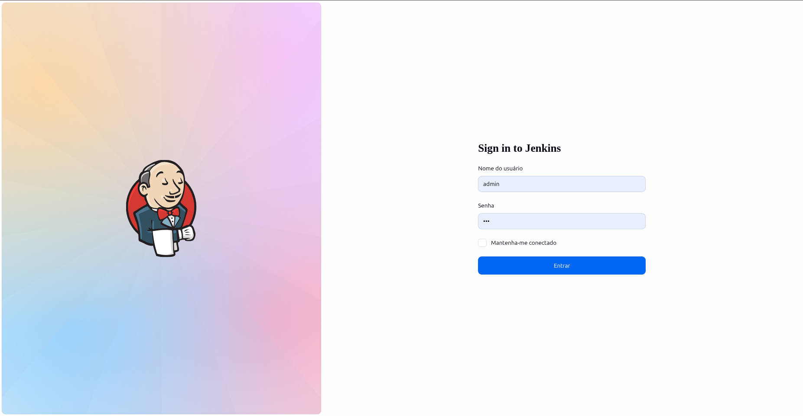
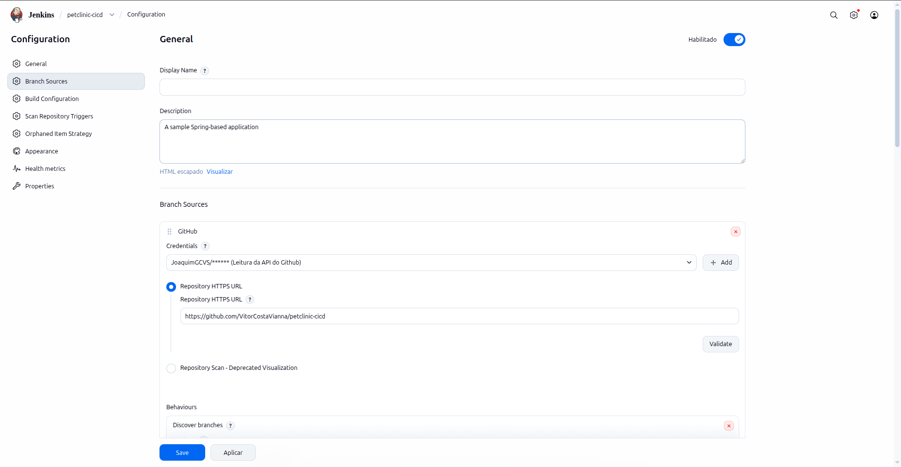
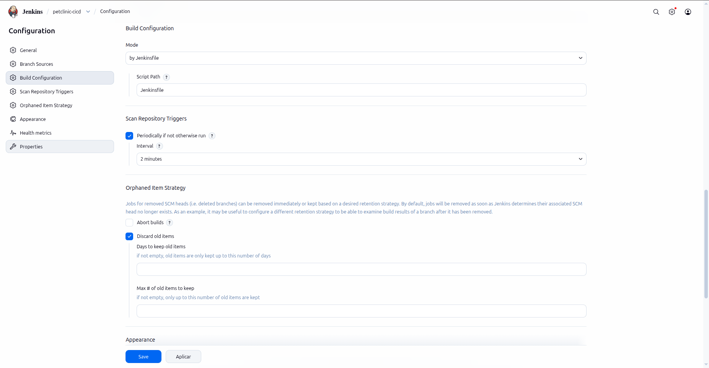
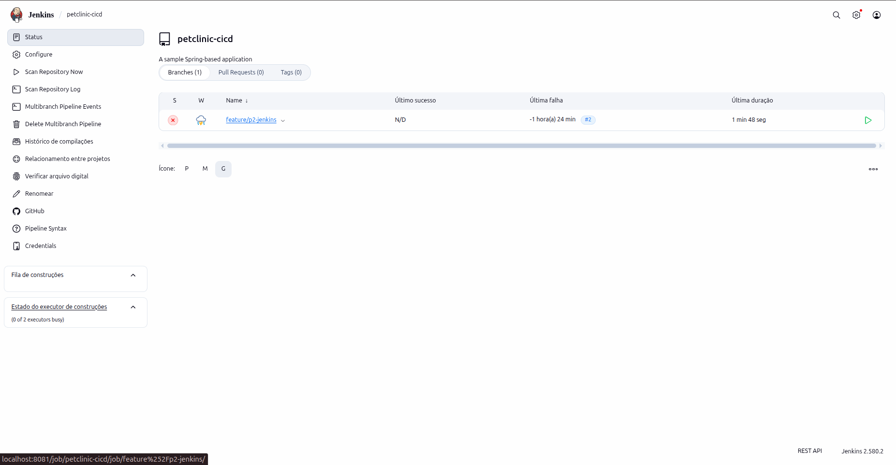
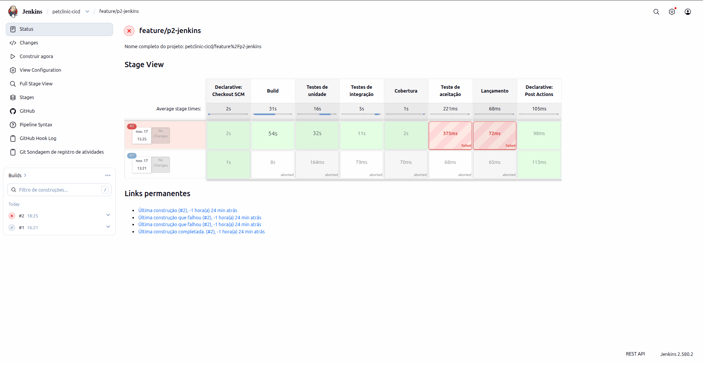
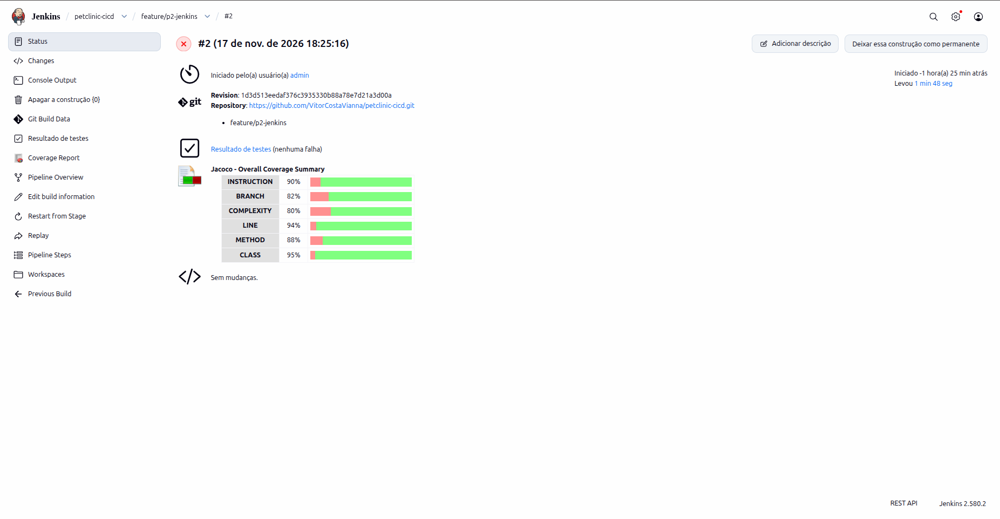

# 2. Papéis, Ferramentas e Ambiente

> Conforme a configuração que foi criada e executada no Jenkins. O ambiente atualmente validado é uma instância local em Docker Compose; a hospedagem em servidor compartilhado não faz parte desta configuração.

## 2.1 Papéis e responsabilidades

| Papel | Responsabilidades |
|---|---|
| P1 — Repositório e testes de integração | Mantém o repositório, as convenções de branches e versões, o build Maven e os testes de integração (`*IT`). Prepara as seções 1, 3 e 4 do Plano, além da montagem do PDF final e do `.zip` do repositório. |
| P2 — Jenkins e integração contínua | Mantém o Jenkins em Docker, os plugins e gatilhos, e o `Jenkinsfile`. Orquestra build, testes, cobertura, aceite e lançamento conforme os artefatos entregues pelos demais integrantes. Prepara esta seção do Plano. |
| P3 — Testes de unidade | Escreve os testes unitários do grupo, fornece os resultados e a cobertura JaCoCo ao Jenkins e prepara a seção de controle de mudanças. |
| P4 — Aceitação e apresentação | Mantém o teste de aceitação Selenium e sua forma de execução no pipeline. Prepara a seção de relatório de status e auditorias e os slides. |
| P5 — Lançamento | Mantém o Dockerfile da aplicação, a publicação da imagem, o deploy e o procedimento de rollback. Prepara a seção de releases, marcos e cronograma. |
| Revisor de Pull Request | Revisa mudanças de outro integrante e verifica os resultados automatizados disponíveis antes da integração. |
| Administrador do GitHub | Mantém os colaboradores e as regras de proteção da `main`. A configuração de proteção não é feita pelo Jenkins. |

O P2 mantém o pipeline, mas não implementa os testes Selenium nem a imagem e o deploy da aplicação. O Jenkinsfile define os pontos de integração: `ci/acceptance.sh` para o aceite da P4; `Dockerfile` e `ci/deploy.sh` para o lançamento da P5. Esses itens ainda precisam ser entregues pelos respectivos responsáveis.

## 2.2 Ferramentas

| Ferramenta | Uso no projeto |
|---|---|
| Git e GitHub | Versionamento, branches, Pull Requests e hospedagem do código-fonte. |
| Jenkins LTS | Indexação das branches e execução do pipeline definido no `Jenkinsfile`. A instância validada executa Jenkins 2.580.2. |
| Docker Engine e Docker Compose | Executam o Jenkins e um daemon Docker-in-Docker usado pelo pipeline para criar containers e imagens. |
| Java | A imagem Jenkins usa JDK 21; o projeto exige Java 17 como versão mínima e compila para essa versão pelo Maven. |
| Maven Wrapper (`./mvnw`) | Compila, empacota e executa os testes sem depender de uma instalação global do Maven. |
| JUnit e JaCoCo | Publicam resultados de testes e cobertura na interface Jenkins. |
| Selenium | Tecnologia prevista para o aceite automatizado, sob responsabilidade da P4. |
| Docker Hub | Repositório previsto para a imagem versionada da aplicação, sob responsabilidade da P5. |

Os plugins Jenkins estão listados em `jenkins/plugins.txt` e instalados durante a construção da imagem: Pipeline, Git, GitHub, GitHub Branch Source, Credentials Binding, JUnit, JaCoCo, Pipeline Stage View, Timestamper e Workspace Cleanup.

## 2.3 Ambiente Jenkins

O ambiente foi iniciado localmente com:

```bash
docker compose -f docker-compose.jenkins.yml up -d --build
```

A interface fica em <http://localhost:8081>, mapeada para a porta 8080 do container `petclinic-jenkins`. Os dados do Jenkins, incluindo o usuário criado no Setup Wizard e a configuração do job, ficam no volume `jenkins_home`.

O Compose também inicia o container `petclinic-docker`, baseado em Docker-in-Docker, em modo privilegiado. O Jenkins acessa esse daemon pela rede interna do Compose em TLS; o endpoint Docker não é publicado numa porta do host. Imagens e containers de build ficam no volume `docker_data`; os certificados do canal TLS ficam em volumes próprios. Essa configuração permite que as etapas futuras de aceite e lançamento usem Docker sem montar o socket do host.

Para encerrar os containers preservando os dados:

```bash
docker compose -f docker-compose.jenkins.yml down
```

Não usar `down -v` durante o trabalho, pois a opção remove também os volumes persistentes. A instância descrita nesta seção está acessível localmente; não foi configurado servidor público, domínio, proxy HTTPS ou acesso remoto ao Jenkins.

## 2.4 Job e gatilhos

Foi criado o job Multibranch Pipeline `petclinic-cicd`, apontado para `https://github.com/VitorCostaVianna/petclinic-cicd` e com caminho do script `Jenkinsfile`. O repositório é público. Para evitar o limite baixo de consultas anônimas da API do GitHub durante a indexação, o Jenkins usa uma credencial de leitura chamada `github-readonly`. O token fica armazenado no cofre de credenciais do Jenkins e não é versionado.

O job está configurado para indexar o repositório periodicamente a cada dois minutos. O Jenkinsfile também declara os gatilhos GitHub Push e Poll SCM (`H/2 * * * *`), mas um webhook do GitHub não foi configurado. Portanto, o mecanismo de atualização comprovado nesta instância é a varredura periódica; não há dependência de ngrok.

Na validação, o Jenkins encontrou o Jenkinsfile na branch `feature/p2-jenkins`. A branch `main` ainda não continha esse arquivo no momento do scan; depois que a mudança for integrada à `main`, o job poderá executar a pipeline para os commits dessa branch. A descoberta de tags também é processada pelo job; o estágio de lançamento restringe a publicação a tags no formato `vX.Y.Z`.

## 2.5 Etapas e credenciais da pipeline

O `Jenkinsfile` organiza o fluxo nas seguintes etapas:

| Etapa | Ação |
|---|---|
| Build | Executa `./mvnw -B --no-transfer-progress -DskipTests package`. |
| Testes de unidade | Executa `./mvnw -B --no-transfer-progress test` e publica os relatórios Surefire/JUnit. |
| Testes de integração | Executa os objetivos Failsafe `integration-test` e `verify` e publica os relatórios de integração/JUnit. |
| Cobertura | Gera o relatório JaCoCo e publica a cobertura no Jenkins. |
| Teste de aceitação | Executará `ci/acceptance.sh`, script executável a ser fornecido pela P4. |
| Lançamento | Executa somente em tag `vX.Y.Z`; constrói e publica a imagem Docker Hub e chama `ci/deploy.sh`, artefatos sob responsabilidade da P5. |

O Jenkinsfile acessa as credenciais apenas durante as etapas que delas necessitam. A credencial `github-readonly` permite consultar o repositório; por ser somente de leitura, não publica status de commit no GitHub. Essa publicação não está configurada como requisito do job. Para o lançamento, o Jenkinsfile espera uma credencial Username/Password com ID `dockerhub-petclinic`; ela ainda depende da configuração da P5. Nenhum token ou senha deve ser armazenado no repositório.

## 2.6 Validação e retenção

O primeiro build manual foi executado na branch `feature/p2-jenkins`. Build, testes de unidade, testes de integração e publicação JaCoCo concluíram sem falhas; a cobertura reportada foi de aproximadamente 89,7% de instruções e 82% de branches. A pipeline terminou em falha na etapa de aceitação porque `ci/acceptance.sh` ainda não existe. Por isso, a etapa de lançamento foi ignorada. A validação do deploy depende das entregas da P4 e da P5.

O Jenkins preserva os 20 builds mais recentes, registra horários e logs por etapa e publica resultados JUnit e JaCoCo na interface. A configuração versionada do serviço está em `docker-compose.jenkins.yml`, `jenkins/Dockerfile` e `jenkins/plugins.txt`; os volumes do Jenkins e do Docker-in-Docker permanecem locais e não são parte do repositório.

## 2.7 Evidências da configuração

As capturas abaixo documentam o acesso e a configuração do job, a descoberta da branch e a execução da pipeline. Senhas e tokens aparecem mascarados na interface.

### Figura 1 — Acesso à instância local do Jenkins



---

### Figura 2 — Repositório e credencial da fonte GitHub



---

### Figura 3 — Jenkinsfile e intervalo de varredura



---

### Figura 4 — Branch descoberta pelo job multibranch



---

### Figura 5 — Resultado dos estágios da pipeline

Build, testes unitários, testes de integração e cobertura passaram. A etapa de aceitação falhou pela ausência do script da P4; o lançamento foi ignorado após essa falha.



---

### Figura 6 — Resultados de testes e cobertura JaCoCo


