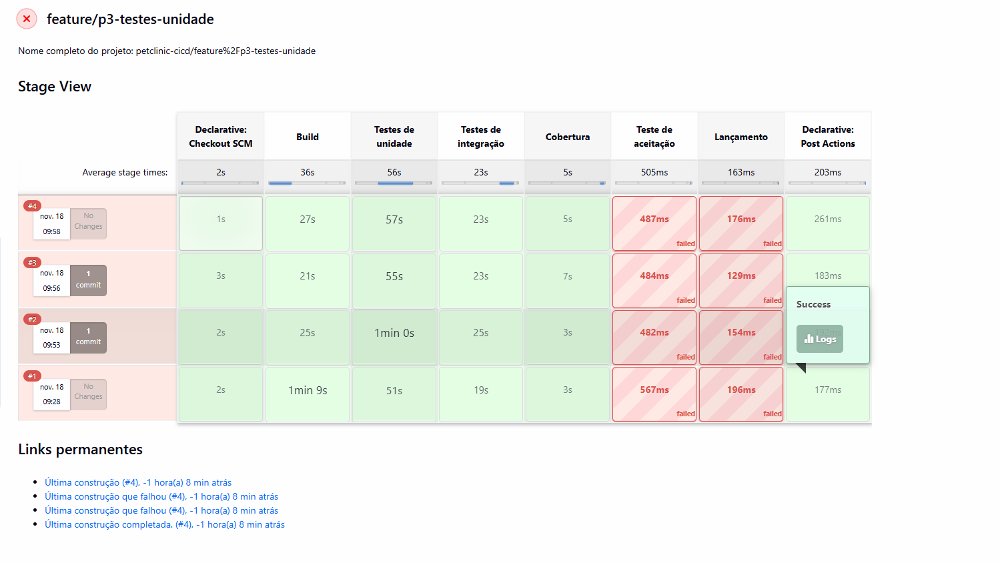
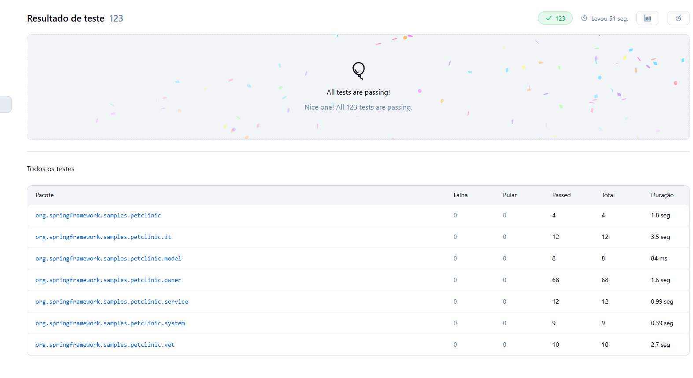
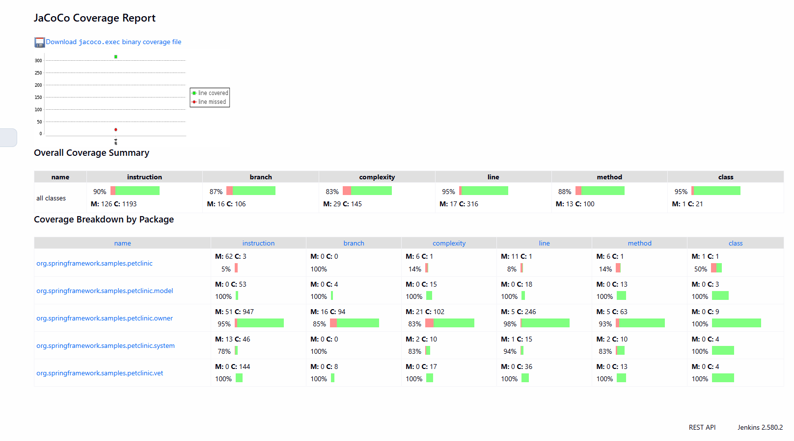
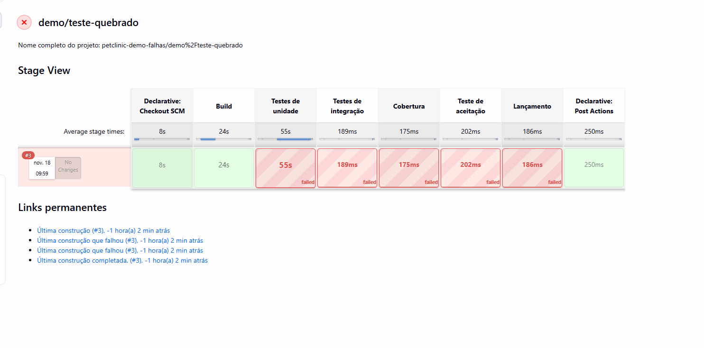
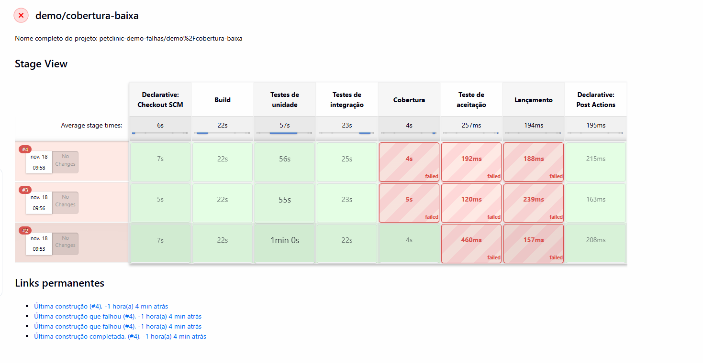

# 5. Controle de Mudanças

> Seção da Pessoa 3. Define como uma mudança em qualquer Item de Configuração (IC, seção 3) é solicitada, avaliada, implementada, revisada, aprovada e integrada à `main`. O fluxo operacional está resumido em `CONTRIBUTING.md`; esta seção é a referência formal.

## 5.1 Objetivo e princípios

O controle de mudanças garante que **nenhuma alteração entra na baseline de desenvolvimento (BL-1, seção 4) sem ser rastreável, revisada e validada automaticamente**. Princípios adotados:

1. **Toda mudança passa por Pull Request (PR).** Não há commit direto na `main` (regra de proteção da branch, IC-20).
2. **Mudanças pequenas e isoladas.** Uma branch por tarefa e um commit por passo, o que facilita a revisão e a reversão.
3. **Validação automática antes da humana.** O pipeline Jenkins (build, testes de unidade, testes de integração e cobertura) precisa estar verde para o PR ser aprovado.
4. **Revisão por outra pessoa.** Quem escreve a mudança não aprova o próprio PR.
5. **Histórico preservado.** Erros são corrigidos com novos commits ou `git revert`, nunca reescrevendo a `main` (sem `force push`, sem `reset`).

## 5.2 Tipos de mudança

| Tipo | Exemplo | Prefixo da branch | Prefixo do commit | Efeito na versão (SemVer, seção 4.4) |
|---|---|---|---|---|
| Nova funcionalidade ou capacidade | novo estágio do pipeline, novo teste | `feature/pN-...` | `feat:`, `test:`, `ci:` | MINOR |
| Correção | teste instável, erro no Jenkinsfile | `fix/pN-...` | `fix:` | PATCH |
| Documentação | seção do Plano, README | `docs/pN-...` | `docs:` | nenhum (entra na próxima versão) |
| Build e dependências | `pom.xml`, Dockerfile | `feature/pN-...` ou `fix/pN-...` | `build:` | PATCH ou MINOR, conforme o impacto |
| Manutenção | limpeza de arquivos do upstream | `fix/pN-...` | `chore:` | PATCH |
| Mudança incompatível | troca da versão mínima do Java | `feature/pN-...` | `feat!:` ou rodapé `BREAKING CHANGE:` | MAJOR |

`N` é o número do integrante (P1 a P5). Os commits seguem Conventional Commits, em português.

## 5.3 Fluxo de uma mudança

```
Solicitação ─► Análise ─► Branch ─► Implementação ─► PR ─► Pipeline Jenkins ─► Revisão ─► Aprovação ─► Merge na main (BL-1)
                                                            │ vermelho             │ pedidos de ajuste
                                                            └──── volta para Implementação ◄┘
```

| # | Etapa | Quem | Como / evidência |
|---|---|---|---|
| 1 | **Solicitação** | Qualquer integrante | Pedido no grupo ou *issue* no GitHub descrevendo o problema ou a necessidade. |
| 2 | **Análise de impacto** | Solicitante + dono do IC afetado | Identificar os ICs atingidos (seção 3) e seus donos. Se a mudança toca a área de outra pessoa, o dono é avisado antes de começar. |
| 3 | **Criação da branch** | Autor | `git checkout main && git pull` e, em seguida, `git checkout -b feature/pN-descricao`. |
| 4 | **Implementação** | Autor | Commits pequenos; `./mvnw verify` passando localmente (formatação, checkstyle, unidade e integração). Testes novos seguem os sufixos `*Test` (unidade) e `*IT` (integração). |
| 5 | **Abertura do PR** | Autor | PR para a `main` com o template `.github/pull_request_template.md` preenchido: descrição, tipo, área alterada (marcando o dono) e checklist. |
| 6 | **Validação automática** | Jenkins | O job multibranch detecta a branch e executa o `Jenkinsfile`. O resultado de cada estágio, os relatórios JUnit e a cobertura JaCoCo ficam no build. Pipeline vermelho bloqueia a aprovação. |
| 7 | **Revisão** | Revisor (outro integrante; o dono do IC, se for outro) | Lê o diff, confere o checklist e o build verde no Jenkins. Pode aprovar, comentar ou pedir mudanças. |
| 8 | **Aprovação** | Revisor | 1 aprovação no GitHub é obrigatória. Um novo push após a aprovação a invalida (`dismiss_stale_reviews`), exigindo nova revisão. |
| 9 | **Integração (merge)** | Autor ou revisor | **"Rebase and merge"**, que mantém o histórico linear e um commit por passo (autoria preservada). A branch é apagada depois do merge. |
| 10 | **Pós-merge** | Jenkins + autor | O pipeline roda novamente na `main`; o novo commit passa a ser a BL-1. Mudanças visíveis entram no `CHANGELOG.md` na seção `[Não lançado]`. |

## 5.4 Critérios para aprovar um PR

O revisor só aprova se **todos** os itens forem verdadeiros:

- [ ] O build do Jenkins para a branch do PR está verde, sem testes falhando em nenhum dos estágios *Build*, *Testes de unidade*, *Testes de integração* e *Cobertura*.
- [ ] A cobertura JaCoCo não caiu abaixo do mínimo configurado no `Jenkinsfile`. Abaixo dele, o Jenkins marca o build como falho.
- [ ] A branch e os commits seguem as convenções (5.2).
- [ ] Nenhum teste existente foi apagado ou desativado (`@Disabled`) para "fazer o build passar".
- [ ] Mudanças em ICs de outra pessoa têm a ciência do dono, marcado no PR.
- [ ] Não há credenciais, tokens ou senhas no diff (eles ficam no cofre do Jenkins, seção 3.4).
- [ ] O `CHANGELOG.md` foi atualizado quando a mudança é visível ao usuário ou ao pipeline.

## 5.5 Autoridade de aprovação por IC

| IC (seção 3) | Dono | Aprovação exigida |
|---|---|---|
| IC-01, IC-02 (código da aplicação) | Grupo | 1 revisor qualquer. Mudança funcional está fora do escopo (seção 1.2) e precisa de consenso do grupo. |
| IC-03, IC-04 (`pom.xml`, wrapper) | P1 | 1 revisor, sendo P1 se o autor for outra pessoa. |
| IC-05 (testes de unidade) | P3 | 1 revisor, sendo P3 se o autor for outra pessoa. |
| IC-06 (testes de integração) | P1 | 1 revisor, sendo P1 se o autor for outra pessoa. |
| IC-07 (testes de aceitação) | P4 | 1 revisor, sendo P4 se o autor for outra pessoa. |
| IC-09, IC-10 (`Jenkinsfile`, Jenkins) | P2 | 1 revisor, sendo P2 se o autor for outra pessoa. |
| IC-11, IC-12 (Dockerfile, imagem) | P5 | 1 revisor, sendo P5 se o autor for outra pessoa. |
| IC-15 (Plano de GC) | P1 (montagem) e autor da seção | 1 revisor; P1 confere a consistência entre seções. |
| IC-20 (proteção da `main`) | P1 | Consenso do grupo; apenas o administrador aplica. |
| Criação de tag (BL-2 e BL-3) | P1 | Conforme a seção 4.5. |

## 5.6 Mudanças urgentes e reversão

- **Pipeline quebrado na `main`:** é prioridade do grupo. Quem integrou a mudança abre imediatamente um `fix/pN-...` ou um PR de reversão. O fluxo de PR e revisão continua valendo, com revisão rápida, porque a `main` vermelha bloqueia todos os outros PRs.
- **Reversão:** `git revert <commit>` numa branch `fix/pN-revert-...`, seguido de PR normal. Não se usa `reset` nem `force push` na `main`.
- **Release com defeito:** a tag publicada não é movida (seção 4.3). A correção sai como nova versão PATCH, e o rollback da implantação usa a imagem da versão anterior (seção 7, P5).
- **Contorno pelo administrador:** a proteção permite que o administrador (P1) contorne a regra (`enforce_admins: false`) somente em emergência combinada com o grupo. O motivo fica registrado no PR ou no grupo.

## 5.7 Como o pipeline garante o controle

O Jenkins é o "portão" automático do controle de mudanças. Ele recusa qualquer mudança que quebre o build ou os testes:

| Estágio | O que bloqueia | Como falha |
|---|---|---|
| Build | Erro de compilação, formatação (`spring-javaformat`) ou checkstyle | `./mvnw package` termina com erro e o estágio fica vermelho. |
| Testes de unidade | Qualquer teste `*Test`/`*Tests` falhando | `./mvnw test` termina com erro. O relatório JUnit é publicado mesmo assim (`post { always }`), mostrando qual teste quebrou. |
| Testes de integração | Qualquer teste `*IT` falhando | O objetivo `failsafe:verify` termina com erro. |
| Cobertura | Cobertura abaixo do mínimo (85% de instruções, 75% de branches, 85% de linhas) | O plugin JaCoCo marca o build como falho (`changeBuildStatus: true`) e o estágio interrompe o pipeline com erro. |
| Teste de aceitação | Falha no teste Selenium (P4) | Script `ci/acceptance.sh` termina com erro. |

Quando um estágio falha, os seguintes são pulados ("skipped due to earlier failure"). Isso foi comprovado no Jenkins com duas branches de demonstração: um teste quebrado (o pipeline para em *Testes de unidade*) e uma exigência de 99% de cobertura (o pipeline para em *Cobertura*). Assim, uma mudança que quebra testes nunca chega ao aceite nem ao lançamento.

## 5.8 Registro e rastreabilidade

Cada mudança deixa um rastro que permite responder **o quê, quem, quando, por quê e com que resultado**:

| Pergunta | Onde está |
|---|---|
| O quê | Diff do PR e commits (`git log`, `git show`) |
| Quem | Autor dos commits e revisor que aprovou o PR |
| Quando | Datas dos commits, do merge e do build |
| Por quê | Descrição do PR, *issue* e mensagem do commit |
| Resultado | Build do Jenkins associado ao commit: estágios, relatórios JUnit e cobertura JaCoCo |
| Em qual versão | `CHANGELOG.md` e tag `vX.Y.Z` (seção 4) |

Esses registros alimentam o relatório de status e as auditorias (seção 6, P4).

## 5.9 Exemplo real: testes de unidade da P3

1. **Solicitação e análise:** o trabalho exige testes de unidade no estágio *Commit*. Os ICs afetados são IC-05 (testes de unidade, da P3), IC-19 (`CHANGELOG.md`) e IC-16 (inventário), da P1, e IC-09 (`Jenkinsfile`, da P2) para o limite de cobertura.
2. **Branch:** `feature/p3-testes-unidade`, criada a partir da `main`.
3. **Implementação:** um commit `test:` por classe testada (34 testes em `BaseEntityTest`, `NamedEntityTest`, `OwnerTest`, `PetTest`, `VisitTest`, `VetTest`, `VetsTest` e `WebConfigurationTest`), mais um commit `ci:` para o limite de cobertura e um `docs:` para o `CHANGELOG.md` e o inventário.
4. **PR:** aberto para a `main`, marcando P1 e P2 por tocar IC-09, IC-16 e IC-19.
5. **Validação:** ao rodar no Jenkins, a validação encontrou dois defeitos no limite de cobertura. O plugin ignorava o mínimo sem um máximo e, quando reprovava, não interrompia o pipeline. Os dois foram corrigidos no mesmo PR com commits `fix:`, sem reescrever o histórico. Esse é o fluxo da seção 5.3 em funcionamento: o pipeline aponta o problema antes de a mudança chegar à `main`.
6. **Revisão e integração:** aprovação por outro integrante e integração por "Rebase and merge".

## 5.10 Evidências no Jenkins

As capturas abaixo foram feitas numa instância local do Jenkins, criada com a mesma configuração versionada pela P2 (`docker-compose.jenkins.yml`) e o mesmo `Jenkinsfile`. As branches `demo/*` existem apenas num clone local, usado para provocar as falhas. Elas nunca foram enviadas ao GitHub nem integradas.

### Figura 7 — Pipeline da branch `feature/p3-testes-unidade`

Build, testes de unidade, testes de integração e cobertura passaram. O teste de aceitação falha porque `ci/acceptance.sh` (P4) ainda não existe. O lançamento só roda em tags `vX.Y.Z`.



---

### Figura 8 — Resultados de teste publicados (JUnit)

123 testes passando: 111 de unidade (77 do upstream e 34 da P3) e 12 de integração (P1).



---

### Figura 9 — Cobertura publicada (JaCoCo)

Cobertura de 90% das instruções, 87% dos branches e 95% das linhas, acima dos mínimos de 85%, 75% e 85%.



---

### Figura 10 — Um teste quebrado bloqueia a mudança

Na branch `demo/teste-quebrado`, uma asserção de `VetsTest` foi alterada de propósito. O estágio *Testes de unidade* falha e os estágios seguintes são pulados.



---

### Figura 11 — Cobertura abaixo do mínimo bloqueia a mudança

Na branch `demo/cobertura-baixa`, o mínimo de instruções foi elevado para 99%. Nos builds #3 e #4, o estágio *Cobertura* falha e interrompe o pipeline. O build #2 é anterior à correção descrita no item 5 da seção 5.9: nele a cobertura ainda não bloqueava o pipeline.


