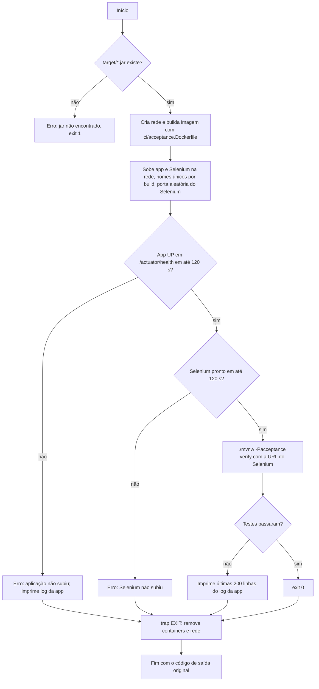
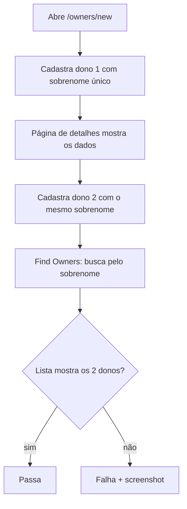
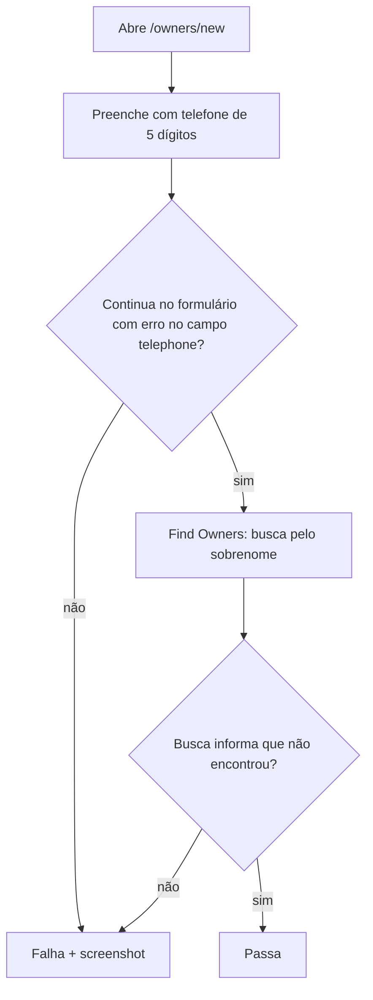

# Teste de aceitação com Selenium (P4)
Status: aprovada (2026-11-24)

## Problema e objetivo
O estágio "Teste de aceitação" do Jenkins chama `ci/acceptance.sh`, que ainda não existe, e por isso todo build falha nesse estágio. Esta mudança entrega o script e um teste de aceitação automatizado com Selenium. O script sobe a aplicação num container, executa o teste num navegador real (Chrome em container) e derruba tudo ao final. O resultado aparece no Jenkins como relatório JUnit e, se falhar, com screenshot e log da aplicação.

## Fora do escopo
- Dockerfile definitivo, publicação no Docker Hub e deploy (P5). Aqui há um Dockerfile **provisório**, usado só no aceite.
- Testes não funcionais (desempenho, carga).
- Outros fluxos além do cadastro e da busca de dono (pets, visitas, veterinários já têm unidade/IT).
- Webhook ou mudança de gatilho do Jenkins (P2).

## Fluxos

### Fluxo do script `ci/acceptance.sh`

### Fluxo do teste: caminho feliz

### Fluxo do teste: erro crítico

## Design estrutural
N/A: cria uma classe de teste (`OwnerRegistrationAT`) e scripts de CI; não há módulo novo nem interface pública alterada.

### Dependências novas
| Pacote (nome exato) | Versão | Para que serve aqui | Existe no registro? | Publisher | Alternativa sem dependência |
|---|---|---|---|---|---|
| `org.seleniumhq.selenium:selenium-java` (escopo `test`) | gerenciada pelo BOM do Spring Boot 4.1.0 (sem versão no `pom.xml`) | `RemoteWebDriver` para controlar o Chrome | sim (Maven Central) | SeleniumHQ | não há: Selenium é a tecnologia exigida |
| imagem `selenium/standalone-chrome` | tag fixa, na versão do grid igual à do `selenium-java` resolvido | navegador Chrome + Selenium Grid | sim (Docker Hub) | SeleniumHQ | Chrome na imagem do Jenkins (rejeitado, Q2) |
| imagem `eclipse-temurin:17-jre` | tag `17-jre` | base do Dockerfile provisório | sim (Docker Hub) | Eclipse Adoptium | — |

### Reuso
- Jar gerado pelo estágio Build (`target/*.jar`).
- Actuator já existente (`/actuator/health`) para saber se a aplicação subiu.
- Gatilho existente no `Jenkinsfile`: `ci/acceptance.sh`.

## Decisões importantes
| # | Decisão | Opções consideradas | Escolha | Motivo | Reversível? |
|---|---------|---------------------|---------|--------|-------------|
| D1 | Linguagem do teste | Java/JUnit; Python | Java/JUnit, sufixo `*AT.java`, profile Maven `acceptance` (failsafe) | mesma stack, relatório JUnit nativo | sim |
| D2 | Onde roda o navegador | container `selenium/standalone-chrome`; Chrome na imagem do Jenkins | container | não mexe na imagem do Jenkins (P2) | sim |
| D3 | Dockerfile | `ci/acceptance.Dockerfile`; `Dockerfile` na raiz | `ci/acceptance.Dockerfile` | não colide com o da P5 nem ativa o Lançamento | sim; troca de uma linha quando a P5 entregar |
| D4 | Cenários | só feliz; feliz + erro | feliz + telefone inválido | política de testes: E2E = feliz + 1 erro crítico | sim |
| D5 | Ambiente | só Jenkins; Jenkins + máquina local | os dois, com `SELENIUM_HOST` derivado de `DOCKER_HOST` (padrão `localhost`) | depurar e gravar demonstração | sim |
| D6 | Resultado no Jenkins | `post { junit }` + screenshot; não mexer | `junit` em `target/acceptance-reports/` + `archiveArtifacts` do screenshot (aviso à P2) | evidência para a seção 6 e slides | sim |
| D7 | Builds paralelos de branches diferentes | nomes únicos + porta aleatória; nomes fixos | nomes com `BUILD_TAG` e porta do Selenium aleatória (`docker port`) | o mesmo DinD é compartilhado | sim |
| D8 | "Aparece na lista" | 1 dono (PetClinic redireciona para detalhes quando há 1 resultado); 2 donos com mesmo sobrenome; usar "Davis" do `data.sql` | 2 donos com sobrenome único | a lista só aparece com 2+ resultados; não depende do `data.sql` | sim |
| D9 | Asserções | por texto traduzido; por dados e estrutura | por dados digitados, campo com erro e URL | não quebra com o idioma do navegador | sim |
| D10 | Relatórios | `target/failsafe-reports`; pasta própria | `target/acceptance-reports` | o `junit` do aceite não recontar os `*IT` | sim |

## Regras de negócio
- RN01: o telefone do dono precisa ter exatamente 10 dígitos (`@Pattern("\\d{10}")` em `Owner`).
- RN02: a busca por sobrenome com 2+ resultados mostra a lista de donos; sem resultado, continua no Find Owners com erro no campo `lastName`.

## Critérios de aceite (testáveis)
- CA01: Dado a aplicação no ar, quando cadastro dois donos com o mesmo sobrenome e busco por esse sobrenome, então a lista mostra os dois, com nome e telefone digitados.
- CA02: Dado a aplicação no ar, quando envio o cadastro com telefone de 5 dígitos, então continuo no formulário com erro no campo telefone, e a busca pelo sobrenome não encontra o dono.
- CA03: Quando um teste falha, o script termina com código ≠ 0, o estágio fica vermelho e o Lançamento não roda.
- CA04: Ao final do script, com sucesso ou falha, não sobra container nem rede criados por ele.
- CA05: Se a aplicação não ficar UP em 120 s, o script termina com código ≠ 0 e mensagem "aplicação não subiu", com o log da aplicação.
- CA06: O resultado aparece na aba de testes do build no Jenkins; em falha, o screenshot fica nos artefatos do build.
- CA07: `./mvnw test` e `./mvnw verify` (sem o profile) não executam `*AT`.
- CA08: O mesmo script roda na máquina local (Git Bash + Docker Desktop) sem alteração.

## Matriz de testes
| ID | CA/RN | Caminho exercitado | Técnica | Entrada → resultado esperado | Nível |
|---|---|---|---|---|---|
| T01 | CA01, RN02 | cadastro válido + busca com 2 resultados | partição (válido) | 2 donos "Acceptance<sufixo>" → lista com 2 linhas com nome e telefone | e2e |
| T02 | CA02, RN01 | cadastro com telefone inválido | caminho de erro | telefone `12345` → erro no campo telephone; busca → erro em lastName | e2e |
| T03 | CA03 | teste quebrado propositalmente | caminho de erro (pipeline) | asserção alterada localmente → script exit ≠ 0 e estágio vermelho (verificação manual com print) | pipeline |
| T04 | CA04 | limpeza em sucesso e em falha | decisão (trap) | após T01/T03: `docker ps -a` e `docker network ls` sem recursos do build | pipeline |
| T05 | CA05 | app não sobe | caminho de erro | imagem com comando que encerra → exit ≠ 0 + "aplicação não subiu" (verificação manual) | pipeline |
| T06 | CA07 | `*AT` fora do surefire/failsafe padrão | decisão (configuração) | `./mvnw verify` → nenhum relatório `*AT` | build |

O valor-limite do telefone (9/10/11 dígitos) já é regra de validação do domínio e não é repetido no E2E (política: E2E não repete caminhos de unidade).

## Casos de borda e erros
- Jar ausente (estágio Build não gerou) → exit 1 com mensagem.
- Docker indisponível → o primeiro comando `docker` falha e o script termina (`set -eu`).
- Porta 4444 ocupada por outro build → evitado com porta aleatória.
- Selenium demora a subir → espera de até 120 s em `/status`.
- Elemento demora a aparecer → espera explícita de 10 s, sem `sleep` fixo.

## Impacto
- `pom.xml` (P1): dependência `selenium-java` em `test` e profile `acceptance`.
- `Jenkinsfile` (P2): `post { always { junit ...; archiveArtifacts ... } }` no estágio de aceitação.
- Tempo do pipeline: + ~1 a 2 min (imagens, subida da app).
- Sem impacto em banco, APIs ou dados (H2 em memória, descartado com o container).

## Perguntas em aberto
- (nenhuma)
