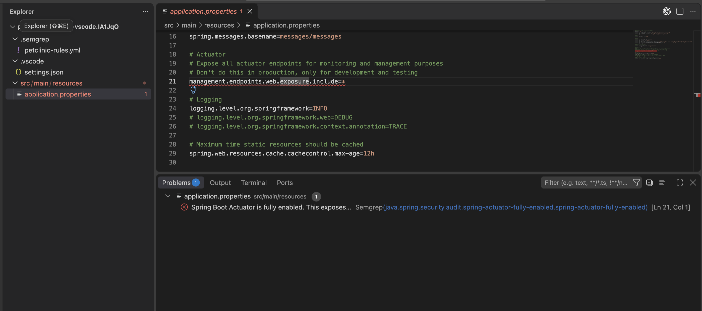

# Pipeline DevSecOps de Spring PetClinic

GitHub Actions ejecuta los jobs `secretos`, `sast` y `sca` cuando se abre o se actualiza un pull request hacia `develop` o `main`. Los tres controles cubren el historial de Git, la configuración de la aplicación y las dependencias presentes en el JAR. [Workflow DevSecOps](../.github/workflows/devsecops.yml)

## Herramientas y justificación

| Job | Herramienta | Qué verifica y por qué |
| --- | --- | --- |
| `secretos` | Gitleaks | Examina el historial de Git para detectar credenciales que podrían seguir accesibles en commits anteriores. Los valores detectados se ocultan en el log. |
| `sast` | Semgrep | Aplica reglas locales a `src/main/resources` para detectar configuraciones inseguras antes de integrar cambios. La regla de Actuator permite identificar la exposición de todos sus endpoints desde el editor y en CI. |
| `sca` | Syft y Grype | Syft inventaría los componentes del JAR empaquetado y publica el SBOM CycloneDX como artefacto. Grype usa ese inventario para identificar dependencias con vulnerabilidades conocidas. |

## Política de bloqueo y reportes

Gitleaks hace fallar `secretos` si detecta un posible secreto. Semgrep hace fallar `sast` si una regla de severidad `ERROR` detecta un hallazgo. Grype hace fallar `sca` ante vulnerabilidades `High` o `Critical` con corrección disponible. Para impedir una fusión por un check fallido, GitHub debe exigir ese check en la rama destino. [Política de bloqueo](../security/politica-de-bloqueo.md)

Semgrep y Grype publican sus reportes SARIF en GitHub Code scanning cuando generan el archivo y el PR se origina en el mismo repositorio. Un hallazgo bloqueante conserva el estado fallido del check y el reporte generado queda disponible para publicación.

## Resultados del avance

Semgrep detectó la exposición de Spring Boot Actuator en una copia de la configuración anterior a la corrección. La captura muestra el hallazgo en el panel **Problems** de VS Code y la línea 21 de `application.properties`.

En el PR hacia `main` pasaron los siete checks. La corrida validó los tres jobs DevSecOps, los resultados de Code scanning de Semgrep y Grype y las compilaciones con Java 17 mediante Maven y Gradle. GitHub informó que Code scanning no encontró alertas nuevas en los cambios del PR. [Registro de evidencia](../evidencia/pipeline-devsecops.md)

