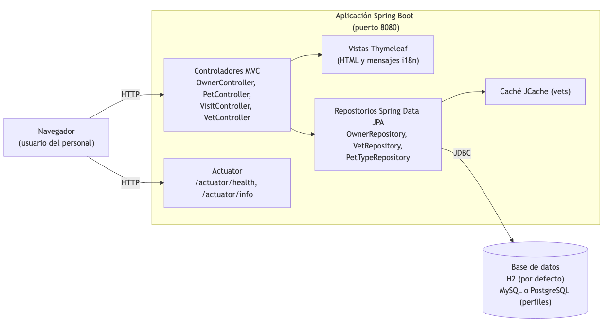
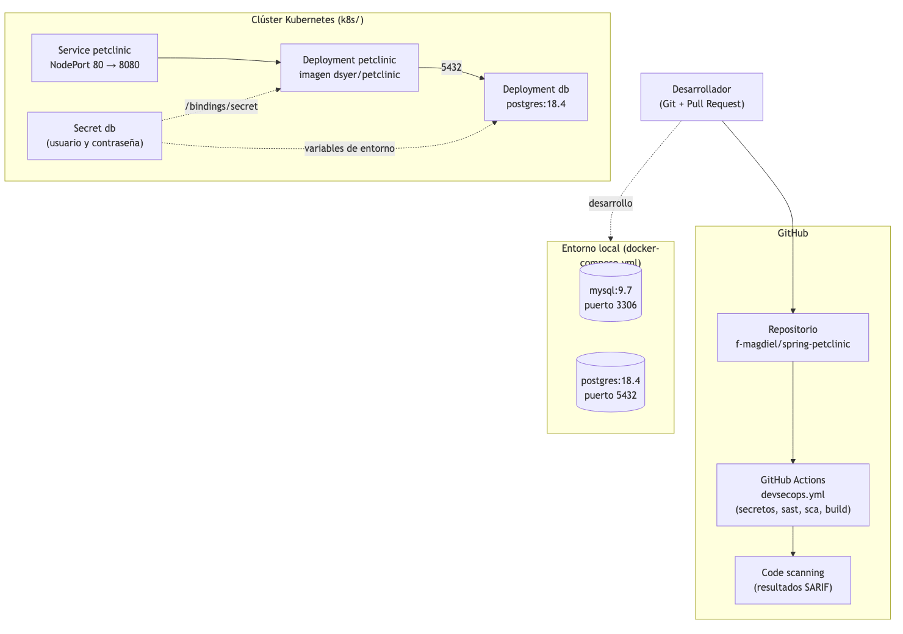
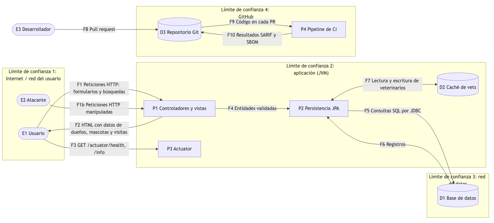
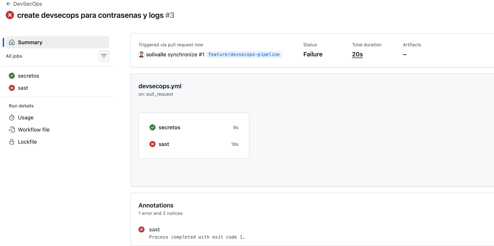
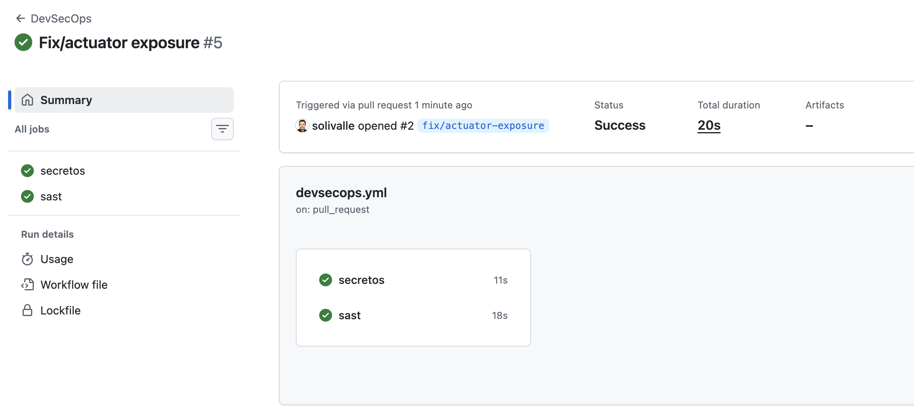
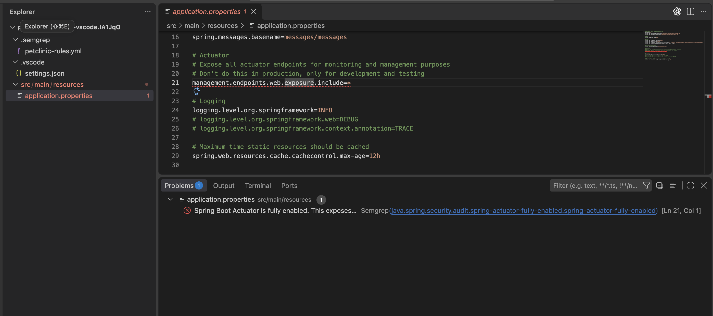
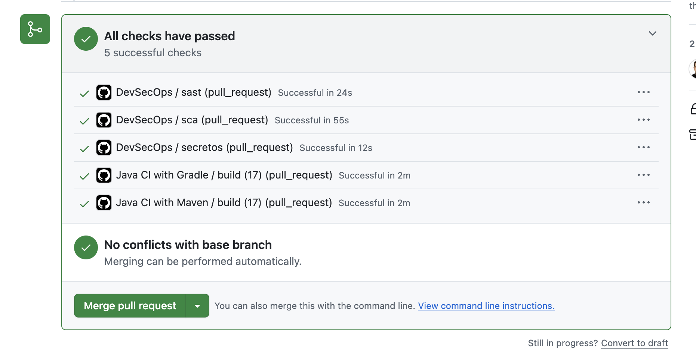

# Avance: desarrollo seguro de Spring PetClinic

**Universidad Galileo · Proyecto final · Entrega de avance (18-nov-2026)**
**Repositorio:** https://github.com/f-magdiel/spring-petclinic

El avance cubre tres puntos: madurez inicial (Fase 0), diseño (Fase 1) y un pipeline con secretos, SAST y SCA (Fases 3 y 4). Este documento resume cada uno y enlaza a los archivos completos del repositorio. Las capturas del pipeline están en [`evidencia/`](../evidencia/).

## 1. Resumen

| Entregable | Estado | Archivo |
|---|---|---|
| Madurez inicial (SAMM) | Hecho | [`security/madurez.md`](../security/madurez.md) |
| Arquitectura | Hecho | [`security/diseño/arquitectura.md`](../security/diseño/arquitectura.md) |
| DFD con límites de confianza | Hecho | [`security/diseño/dfd.md`](../security/diseño/dfd.md) |
| Clasificación de datos | Hecho | [`security/diseño/clasificacion-datos.md`](../security/diseño/clasificacion-datos.md) |
| 10 o más requisitos ASVS | Hecho (18 requisitos) | [`security/diseño/requisitos-asvs.md`](../security/diseño/requisitos-asvs.md) |
| Pipeline con `secretos`, `sast` y `sca` | Hecho, en verde en PR hacia `main` | [`.github/workflows/devsecops.yml`](../.github/workflows/devsecops.yml) |
| Política de bloqueo | Hecho | [`security/politica-de-bloqueo.md`](../security/politica-de-bloqueo.md) |
| SBOM CycloneDX | Hecho (artefacto del job `sca`) | [`evidencia/sbom.cdx.json`](../evidencia/sbom.cdx.json) |
| Dependabot | Pendiente | — |
| Checks obligatorios en `main` | Pendiente de verificar en GitHub | — |

## 2. Madurez inicial (OWASP SAMM)

Autoevaluación de las 15 prácticas, con niveles de 0 a 3. El detalle y la justificación de cada práctica están en `security/madurez.md`.

| Función | Promedio actual | Promedio objetivo (2-dic) |
|---|---|---|
| Gobernanza | 0.3 | 1.3 |
| Diseño | 0.0 | 1.7 |
| Implementación | 1.7 | 2.0 |
| Verificación | 1.0 | 1.7 |
| Operaciones | 0.3 | 1.0 |

La mayor brecha está en **Diseño**: no existía modelo de amenazas ni requisitos de seguridad formales. Los puntos fuertes son la construcción segura (SBOM y gates en el pipeline) y las pruebas de seguridad (SAST y SCA en cada PR).

## 3. Diseño

### 3.1 Arquitectura

Aplicación monolítica en Spring Boot 4.1.2 y Java 17, con vistas Thymeleaf y persistencia JPA sobre H2, MySQL o PostgreSQL. **No incluye Spring Security**: no hay autenticación, autorización ni protección CSRF integrada. Se despliega con `docker-compose.yml` para desarrollo y con los manifiestos de `k8s/`. Los diagramas de componentes y de despliegue están en `security/diseño/arquitectura.md`.

### 3.2 DFD y límites de confianza

Cuatro límites de confianza: Internet y usuario, aplicación, base de datos y GitHub. El DFD tiene 11 flujos y es la base del modelo STRIDE de la Fase 2. Los controles actuales en el límite cliente a aplicación son Bean Validation y los binders que bloquean el campo `id`. Faltan autenticación, TLS, CSRF y cabeceras de seguridad. Ver `security/diseño/dfd.md`.

### 3.3 Clasificación de datos

| Dato | Nivel |
|---|---|
| Nombre, dirección y teléfono del dueño | Confidencial |
| Descripción de la visita (texto libre) | Confidencial |
| Nombre y fecha de nacimiento de la mascota | Interno |
| Veterinarios y especialidades | Público |
| Credenciales de base de datos | Restringido |

### 3.4 Requisitos ASVS

18 requisitos de ASVS 4.0.3 (nivel 1 y 2) aplicados a PetClinic.

| Estado | Cantidad |
|---|---|
| Cumple | 7 |
| Parcial | 4 |
| No cumple | 5 |
| Pendiente de verificar | 2 |

Los que no cumplen son control de acceso, CSRF, TLS, cabeceras de seguridad y modelo de amenazas. Alimentan la remediación y la Fase 2.

## 4. Pipeline DevSecOps

El workflow [DevSecOps](../.github/workflows/devsecops.yml) se ejecuta en cada PR hacia `develop` y `main`, con permisos mínimos y acciones fijadas por SHA.

| Job | Herramienta | Bloquea el PR cuando |
|---|---|---|
| `secretos` | Gitleaks | Hay un secreto en el historial |
| `sast` | Semgrep | Una regla de severidad `ERROR` encuentra algo |
| `sca` | Syft y Grype | Hay una vulnerabilidad High o Critical con corrección disponible |

### 4.1 Gate de SAST: antes y después

La regla propia de Semgrep detectó `management.endpoints.web.exposure.include=*` en `application.properties`, que expone todos los endpoints de Actuator. El PR #1 quedó en rojo. El PR #2 cambió el valor a `health,info` y el pipeline pasó a verde.

| Antes: `sast` en rojo | Después: `sast` en verde |
|---|---|
|  |  |

### 4.2 Gate de SCA: antes y después

Syft generó el SBOM CycloneDX (94 componentes). Grype bloqueó el PR por vulnerabilidades High o Critical con corrección en Tomcat embebido, Spring MVC, Jackson y el controlador JDBC de PostgreSQL. El PR #3 actualizó Spring Boot de 4.1.0 a 4.1.2 y el job pasó a verde.

| Antes: Grype bloquea | Después: Grype en verde |
|---|---|
|  |  |

### 4.3 Resultados en Code scanning

Semgrep y Grype publican SARIF en **Security → Code scanning**.

### 4.4 PR hacia `main`

Siete checks exitosos: `secretos`, `sast`, `sca`, Code scanning de Grype, Code scanning de Semgrep OSS y los builds de Gradle y Maven.

El detalle de cada corrida está en [`evidencia/pipeline-devsecops.md`](../evidencia/pipeline-devsecops.md).

## 5. Pendiente para la entrega final (2-dic)

- Configurar Dependabot y verificar que los checks `secretos`, `sast` y `sca` sean obligatorios en la protección de `main`.
- Modelo de amenazas STRIDE (12 o más amenazas) con trazabilidad a ASVS y al pipeline.
- IaC (Dockerfile y manifiestos endurecidos), DAST con ZAP, Dependency-Track y DefectDojo.
- Remediación de los 5 hallazgos con PR (van 2: Actuator y Spring Boot 4.1.2).
- Plan de pentest y madurez final para comparar contra este diagnóstico.
- Completar los 3 requisitos ASVS de configuración, logs y dependencias con la Persona 3.
