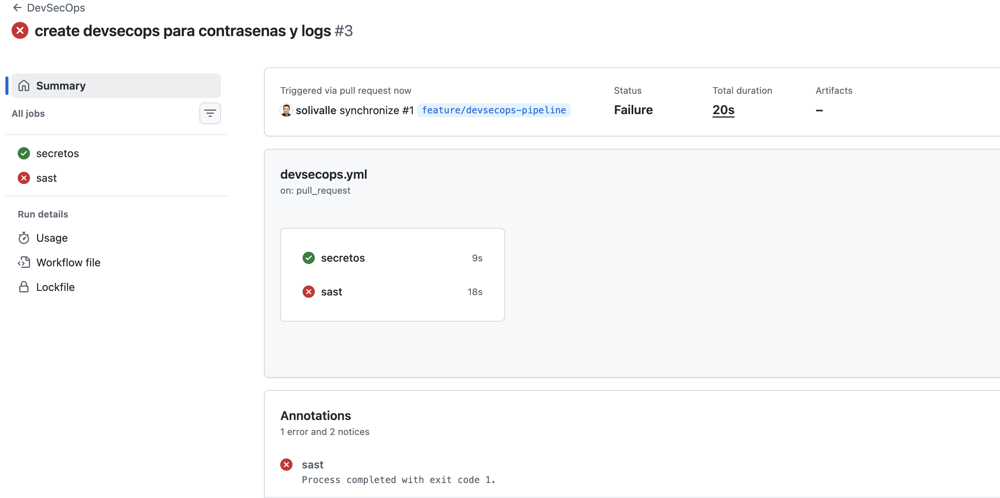
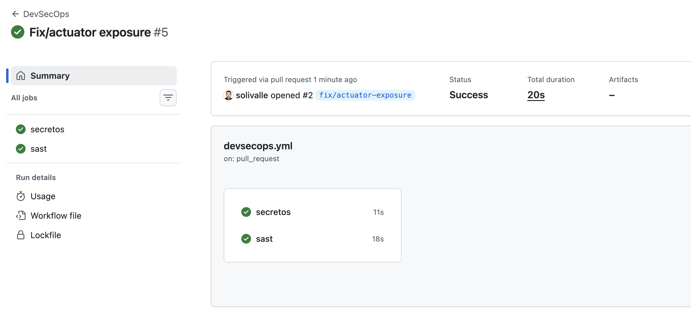

# Evidencia del pipeline DevSecOps

## Paso 1 · Escaneo de secretos con Gitleaks

**Entregable.** El job `secretos` está definido en [`.github/workflows/devsecops.yml`](../.github/workflows/devsecops.yml). GitHub Actions lo ejecuta al abrir o actualizar un pull request con destino a `develop` o `main`.

**Cómo funciona.** GitHub Actions descarga el repositorio con su historial de Git y ejecuta Gitleaks con permisos de solo lectura. Gitleaks busca posibles contraseñas, tokens y llaves en los commits, incluso si esos valores se borraron de la versión actual del archivo. Si detecta un posible secreto, el job falla y los valores detectados se ocultan en el log. El escaneo usa la imagen oficial fijada por digest y no requiere configurar una clave de API.

**Resultado observado.** En la corrida de GitHub Actions que se muestra abajo, el job `secretos` terminó en verde en 12 segundos. La captura sirve como evidencia de la ejecución del escaneo de secretos.

**Para la defensa.** GitHub Actions ejecuta el workflow del PR. Gitleaks realiza el análisis del historial y su resultado determina si el check pasa o falla. Si configuramos el check como obligatorio en la rama destino, un fallo impide fusionar el PR.

## Paso 2 · Análisis estático con Semgrep

**Entregable.** El job `sast` ejecuta Semgrep con una [regla propia de PetClinic](../.semgrep/petclinic-rules.yml). Semgrep lee los archivos del repositorio y compara su contenido con las reglas configuradas. El análisis se ejecuta sin iniciar la aplicación.

**Qué revisa esta primera regla.** Busca la propiedad `management.endpoints.web.exposure.include=*` en los archivos `application*.properties` de `src/main/resources`. El asterisco permite exponer por HTTP todos los endpoints de monitoreo y diagnóstico disponibles de Spring Boot Actuator. La regla reporta esta configuración con severidad `ERROR` y el job falla si la detecta.

**Resultado observado.** En la corrida #3 del workflow DevSecOps para el PR #1, `secretos` pasó y `sast` falló. Semgrep ejecutó una regla sobre tres archivos y reportó un hallazgo bloqueante, `semgrep.petclinic-actuator-wildcard-exposure`, en la [línea 21 de `application.properties`](../src/main/resources/application.properties#L21). El análisis se completó y el código de salida `1` hizo que GitHub Actions marcara el job en rojo.

**Aviso de la regla.** Semgrep recomendó indicar que la ruta de los archivos se cuenta desde la raíz del repositorio. Se agregó `/` al inicio del patrón. Queda pendiente comprobar el ajuste en la próxima corrida.

## Paso 3 · Corrección de la exposición de Actuator

En `fix/actuator-exposure` se cambió el valor de `management.endpoints.web.exposure.include` de `*` a `health,info` en [`application.properties`](../src/main/resources/application.properties#L20). Con este cambio, la exposición web de Actuator se limita a los endpoints de salud e información.

**Resultado observado.** En la corrida #5 del workflow DevSecOps para el PR #2 hacia `develop`, `secretos` y `sast` pasaron. El workflow terminó en 20 segundos. El resultado de `sast` confirma que la regla de Actuator ya no generó el hallazgo bloqueante documentado en el paso 2.

