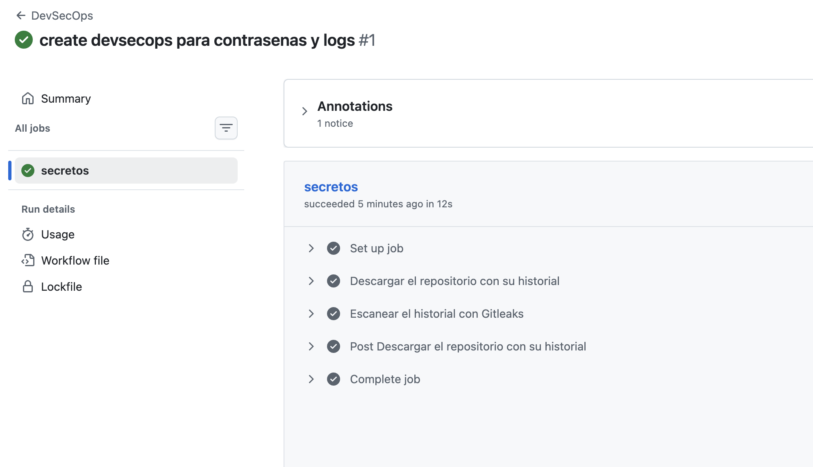

# Evidencia del pipeline DevSecOps

## Paso 1 · Escaneo de secretos con Gitleaks

**Entregable.** El job `secretos` está definido en [`.github/workflows/devsecops.yml`](../.github/workflows/devsecops.yml). GitHub Actions lo ejecuta al abrir o actualizar un pull request con destino a `develop` o `main`.

**Cómo funciona.** GitHub Actions descarga el repositorio con su historial de Git y ejecuta Gitleaks con permisos de solo lectura. Gitleaks busca posibles contraseñas, tokens y llaves en los commits, incluso si esos valores se borraron de la versión actual del archivo. Si detecta un posible secreto, el job falla y los valores detectados se ocultan en el log. El escaneo usa la imagen oficial fijada por digest y no requiere configurar una clave de API.

**Resultado observado.** En la corrida de GitHub Actions que se muestra abajo, el job `secretos` terminó en verde en 12 segundos. La captura sirve como evidencia de la ejecución del escaneo de secretos.

**Para la defensa.** GitHub Actions ejecuta el workflow del PR. Gitleaks realiza el análisis del historial y su resultado determina si el check pasa o falla. Si configuramos el check como obligatorio en la rama destino, un fallo impide fusionar el PR.

El siguiente paso del pipeline es agregar Semgrep para analizar los archivos del repositorio y registrar la evidencia de su primera corrida.
