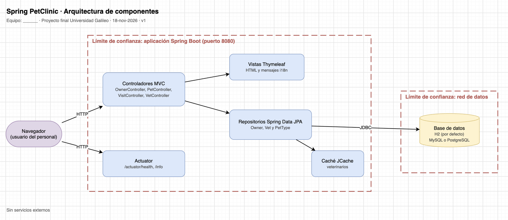
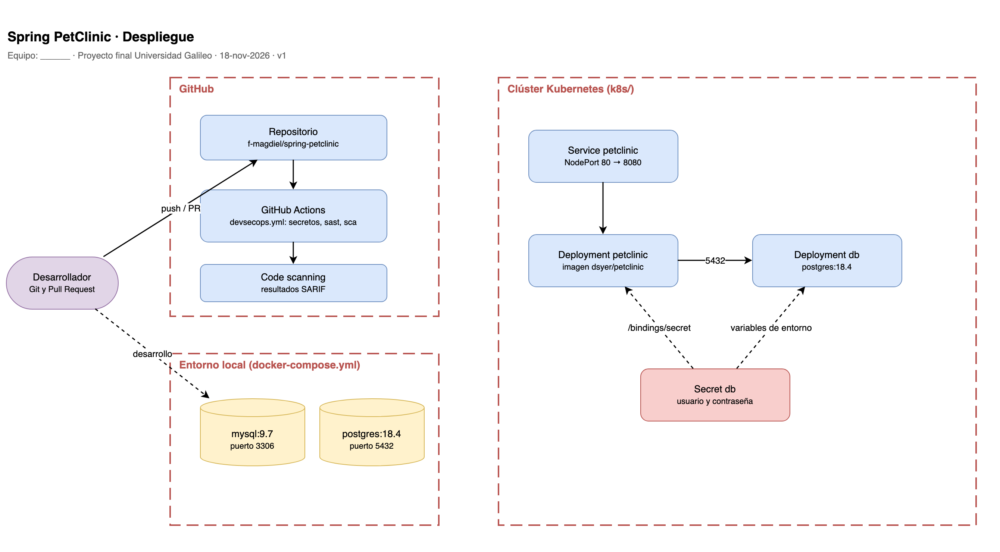

# Arquitectura de Spring PetClinic

Aplicación web monolítica en Spring Boot 4.1.2 y Java 17. Genera HTML en el servidor con Thymeleaf y persiste con Spring Data JPA. **No incluye Spring Security**: no hay autenticación, autorización, ni protección CSRF integrada.

## Componentes

Fuente editable: [`arquitectura.drawio`](img/arquitectura.drawio), página "Componentes".

**Servicios externos:** ninguno. La aplicación no llama a APIs de terceros. Sus únicas dependencias de ejecución son la base de datos y, en k8s, el Secret con las credenciales.

## Perfiles de base de datos

| Perfil | Base de datos | Dónde se configura | Credenciales |
|---|---|---|---|
| (por defecto) | H2 en memoria | `application.properties` | No aplican |
| `mysql` | MySQL | `application-mysql.properties` | Variables `MYSQL_USER` y `MYSQL_PASS` (valor por defecto `petclinic`) |
| `postgres` | PostgreSQL | `application-postgres.properties` | Variables `POSTGRES_USER` y `POSTGRES_PASS` (valor por defecto `petclinic`) |

El esquema y los datos de ejemplo se cargan al arrancar (`spring.sql.init.mode=always`).

## Despliegue

Fuente editable: [`arquitectura.drawio`](img/arquitectura.drawio), página "Despliegue".

## Observaciones de seguridad

Observaciones tomadas del código y de los manifiestos actuales:

| # | Observación | Archivo |
|---|---|---|
| 1 | El tráfico entre navegador y aplicación es HTTP sin TLS. | `k8s/petclinic.yml` (Service NodePort sin Ingress) |
| 2 | La aplicación no autentica ni autoriza a nadie. Cualquier visitante puede crear, ver y editar dueños, mascotas y visitas. | `pom.xml` (sin `spring-boot-starter-security`) |
| 3 | `docker-compose.yml` publica los puertos de las bases de datos y MySQL permite `root` sin contraseña. | `docker-compose.yml` |
| 4 | El Secret de PostgreSQL en k8s guarda la contraseña en claro dentro del manifiesto. | `k8s/db.yml` |
| 5 | Los Deployments no definen `securityContext`, límites de recursos ni usuario no root. | `k8s/petclinic.yml`, `k8s/db.yml` |
| 6 | Actuator expone solo `health` e `info`. | `application.properties` |
| 7 | No hay Dockerfile en el repositorio; la imagen se construye con Spring Boot (`spring-boot:build-image`) o se usa una imagen externa. | `k8s/petclinic.yml` |
