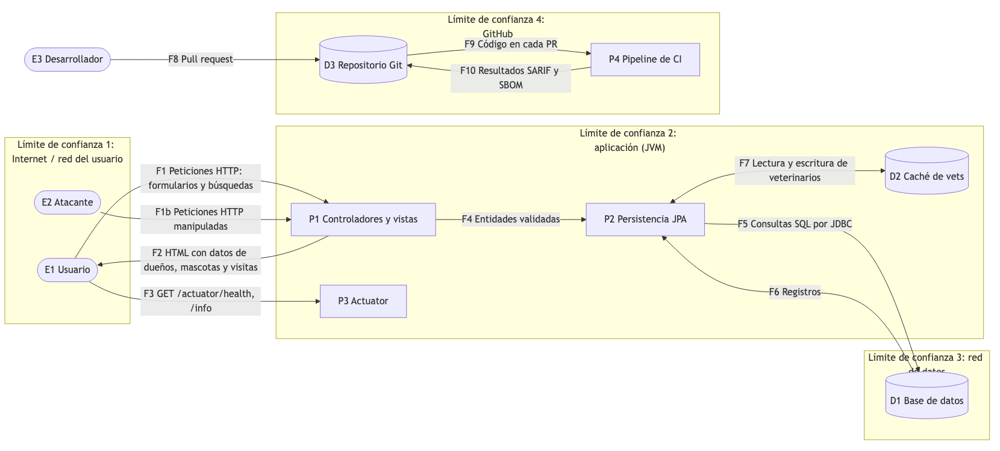
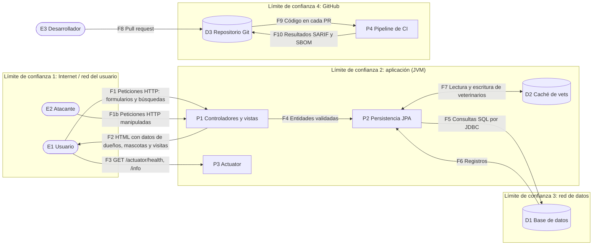

# Diagrama de flujo de datos (DFD) de Spring PetClinic

## Elementos

| Id | Tipo | Elemento | Descripción |
|---|---|---|---|
| E1 | Actor externo | Usuario (personal de la clínica) | Usa el navegador. No se autentica. |
| E2 | Actor externo | Atacante en Internet | Misma capacidad de acceso que E1, con intención maliciosa. |
| E3 | Actor externo | Desarrollador | Cambia código y manifiestos mediante pull requests. |
| P1 | Proceso | Controladores MVC y vistas | `OwnerController`, `PetController`, `VisitController`, `VetController` y plantillas Thymeleaf. |
| P2 | Proceso | Capa de persistencia | Repositorios Spring Data JPA. |
| P3 | Proceso | Actuator | Endpoints `/actuator/health` y `/actuator/info`. |
| P4 | Proceso | Pipeline de CI | GitHub Actions: secretos, SAST, SCA y build. |
| D1 | Almacén | Base de datos | H2, MySQL o PostgreSQL con las tablas `owners`, `pets`, `visits`, `vets`, `specialties`, `types`. |
| D2 | Almacén | Caché de veterinarios | JCache en memoria. |
| D3 | Almacén | Repositorio Git | Código, configuración y manifiestos. |

## Diagrama

Código fuente Mermaid

## Flujos de datos

| Flujo | Origen → Destino | Datos | Protocolo actual | Cruza límite |
|---|---|---|---|---|
| F1 / F1b | E1 / E2 → P1 | Nombre, apellido, dirección, ciudad, teléfono, datos de mascota, descripción de visita, parámetros de búsqueda y paginación | HTTP sin TLS | TB1 → TB2 |
| F2 | P1 → E1 | Páginas HTML con los mismos datos y mensajes de error | HTTP sin TLS | TB2 → TB1 |
| F3 | E1 → P3 | Estado de salud e información de la aplicación | HTTP sin TLS | TB1 → TB2 |
| F4 | P1 → P2 | Entidades `Owner`, `Pet`, `Visit` | Llamada en proceso | Interno |
| F5 / F6 | P2 ↔ D1 | Consultas y registros con datos personales | JDBC, sin TLS configurado | TB2 → TB3 |
| F7 | P2 ↔ D2 | Lista de veterinarios | En memoria | Interno |
| F8 | E3 → D3 | Código, workflows y manifiestos | HTTPS | TB4 |
| F9 / F10 | D3 ↔ P4 | Código fuente, SBOM, resultados SARIF | HTTPS (token del CI) | Interno de TB4 |

## Límites de confianza

| Límite | Qué separa | Controles actuales | Controles que faltan |
|---|---|---|---|
| TB1 → TB2 | Cliente no confiable de la aplicación | Bean Validation en entidades (`@NotBlank`, `@Size`, `@Pattern`), `setDisallowedFields("id", "*.id")` en los binders, validación de paginación | Autenticación, autorización, TLS, protección CSRF, cabeceras de seguridad, límite de peticiones |
| TB2 → TB3 | Aplicación de la base de datos | Consultas parametrizadas de JPA, usuario `petclinic` distinto de root | TLS en JDBC, mínimo privilegio en la base, secretos fuera del repositorio |
| TB4 | Código fuente del entorno de CI | Permisos mínimos, acciones fijadas por SHA, Gitleaks, Semgrep y Grype | Protección de rama `main` con checks obligatorios |

## Amenazas que salen del DFD

Punto de partida para el modelo STRIDE de la Fase 2:

| Flujo o elemento | Amenaza | STRIDE |
|---|---|---|
| F1 / E1 | Cualquiera puede actuar como personal de la clínica | Suplantación |
| F1 | Manipular campos para sobrescribir `id` o datos de otra entidad | Alteración |
| F1 / D1 | Cambios en datos de dueños sin registro de quién los hizo | Repudio |
| F2 | Fuga de datos personales por HTTP sin cifrar o por mensajes de error detallados | Divulgación de información |
| F1 | Búsquedas y paginación abusivas que saturan la aplicación | Denegación de servicio |
| P1 | Cualquier usuario edita o consulta cualquier dueño (sin control de acceso) | Elevación de privilegios |
